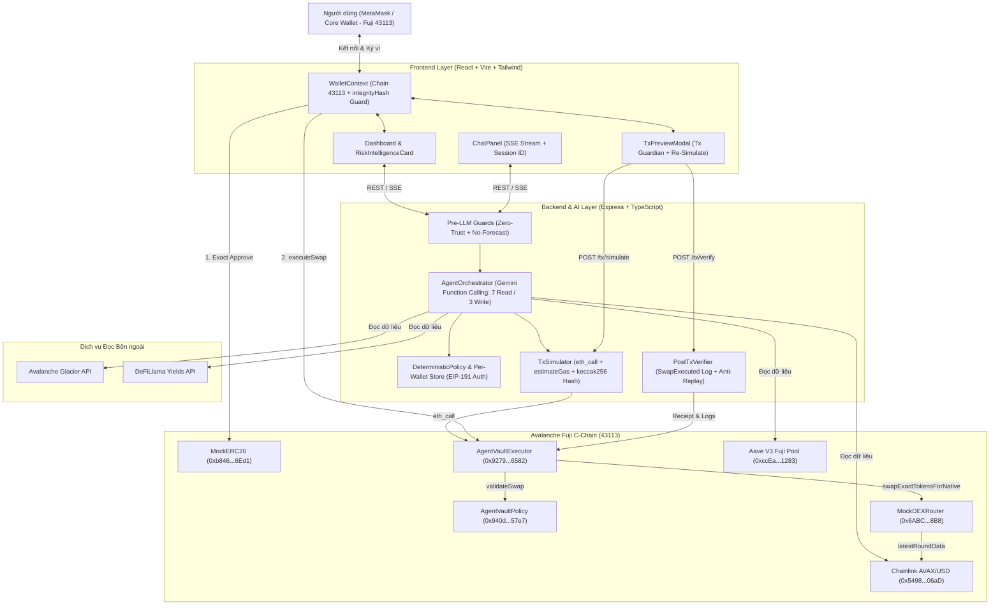
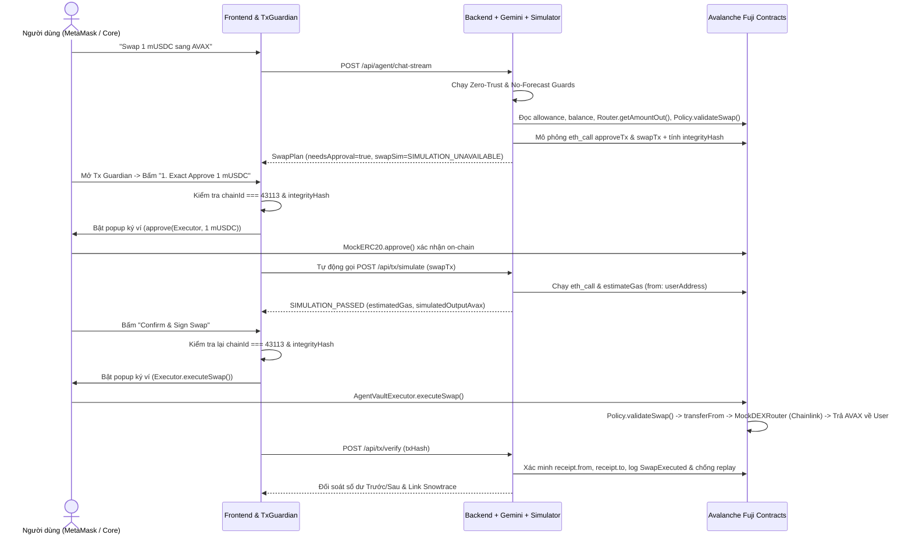

# AgentVault — Đề Án Dự Án (Project Proposal)

**AI DeFi & Risk Copilot Phi Lưu Ký (Non-Custodial) với Cơ Chế Thực Thi Chính Sách On-Chain trên Avalanche**

---

## Mục lục

1. [Tóm tắt Điều hành (Executive Summary)](#1-tóm-tắt-điều-hành-executive-summary)
2. [Đặt vấn đề (Problem Statement)](#2-đặt-vấn-đề-problem-statement)
3. [Giải pháp Đề xuất (Proposed Solution)](#3-giải-pháp-đề-xuất-proposed-solution)
4. [Tính năng Cốt lõi (Core Features)](#4-tính-năng-cốt-lõi-core-features)
5. [Kiến trúc Hệ thống (System Architecture)](#5-kiến-trúc-hệ-thống-system-architecture)
6. [Quy trình & Kịch bản Sử dụng (Workflow & Use Cases)](#6-quy-trình--kịch-bản-sử-dụng-workflow--use-cases)
7. [Đổi mới Kỹ thuật & Vai trò Blockchain](#7-đổi-mới-kỹ-thuật--vai-trò-blockchain)
8. [Mô hình Bảo mật & Tin cậy (Security & Trust Model)](#8-mô-hình-bảo-mật--tin-cậy-security--trust-model)
9. [Ngăn xếp Công nghệ (Technology Stack)](#9-ngăn-xếp-công-nghệ-technology-stack)
10. [Đối tượng Người dùng & Cơ hội Thị trường](#10-đối-tượng-người-dùng--cơ-hội-thị-trường)
11. [Lợi thế Cạnh tranh (Competitive Advantage)](#11-lợi-thế-cạnh-tranh-competitive-advantage)
12. [Lộ trình Phát triển (Roadmap)](#12-lộ-trình-phát-triển-roadmap)
13. [Mô hình Kinh doanh & Bền vững (Định hướng Tương lai)](#13-mô-hình-kinh-doanh--bền-vững-định-hướng-tương-lai)
14. [Kịch bản Demo Trực tiếp (Demo Scenario)](#14-kịch-bản-demo-trực-tiếp-demo-scenario)
15. [Kết luận](#15-kết-luận)

---

## 1. Tóm tắt Điều hành (Executive Summary)

**AgentVault** là một **AI DeFi & Risk Copilot phi lưu ký (non-custodial)** được xây dựng trên **Avalanche Fuji Testnet (`Chain ID: 43113`)**. Hệ thống cho phép người dùng Web3 kiểm tra rủi ro danh mục và vị thế vay/thế chấp bằng ngôn ngữ tự nhiên dựa trên dữ liệu on-chain xác thực, mô phỏng trực tiếp giao dịch trên trạng thái EVM trước khi ký, và thực thi hoán đổi token trong giới hạn **Exact ERC-20 Allowance** cùng **hàng rào Smart Contract Policy on-chain**.

### Vấn đề cốt lõi được giải quyết
Khi đưa AI Agent vào tài chính phi tập trung (DeFi), người dùng đối mặt với hai thái cực rủi ro:
- **Thao tác DeFi thủ công:** Phức tạp, phải tự tính trượt giá (slippage), ngưỡng thanh lý (liquidation threshold), và đọc mã hex calldata khó hiểu khi ký ví.
- **Trao quyền tự động cho AI:** Mở ra nguy cơ tấn công Prompt Injection, AI bịa số liệu (hallucination), cấp quyền chi tiêu vô hạn (`MaxUint256`), hoặc thực hiện giao dịch vượt trần chi tiêu.

### Giải pháp đề xuất
AgentVault tách biệt hoàn toàn **trí tuệ phân tích** khỏi **quyền lưu ký tài sản và quyền cưỡng chế thực thi**:
- **AI Agent (Gemini Function Calling)** chỉ được phép đọc dữ liệu xác định (deterministic) và tạo **kế hoạch giao dịch chưa ký (unsigned transaction plan)**. AI **không bao giờ** giữ private key và không thể tự gửi giao dịch lên mạng.
- **Transaction Guardian** chạy mô phỏng trực tiếp `eth_call` + `eth_estimateGas` trên Avalanche Fuji với địa chỉ ví người dùng, sau đó khóa toàn vẹn dữ liệu bằng mã băm `keccak256` (`integrityHash`) để đối chiếu ngay trước khi ví bật popup ký.
- **Smart Contracts (`AgentVaultPolicy` & `AgentVaultExecutor`)** thực thi cứng các giới hạn ngay trên blockchain (`maxAmountPerTx`, `maxSlippageBps`, whitelist token/router, ngưỡng `minAmountOut`, và công tắc dừng khẩn cấp `Pausable`).

### Giá trị nổi bật
Thay vì yêu cầu người dùng tin tưởng mù quáng vào AI hay một máy chủ backend tập trung, AgentVault thiết lập **ranh giới tin cậy có thể kiểm chứng**: ngay cả khi AI bị đánh lừa bởi Prompt Injection hoặc Backend bị xâm nhập, Smart Contract trên Avalanche Fuji và kiểm tra chữ ký phía trình duyệt vẫn chặn đứng mọi giao dịch vi phạm chính sách.

---

## 2. Đặt vấn đề (Problem Statement)

### Các vấn đề thực tế trong hệ sinh thái AI Agent & Web3
1. **Rủi ro lưu ký khi trao quyền cho AI:** Nhiều mô hình AI Agent tự động yêu cầu người dùng nạp tiền vào ví nóng do backend kiểm soát hoặc chia sẻ session key quyền rộng. Chỉ một lỗi bảo mật ở backend có thể làm mất toàn bộ tài sản.
2. **Ký giao dịch mù (Blind Signing):** Ví Web3 thông thường chỉ hiển thị calldata dạng hex (`0x...`). Người dùng phổ thông khó kiểm chứng được calldata có khớp với lời mô tả của AI hay có bị gài lệnh `approve` vô hạn hay không.
3. **Ảo giác số liệu tài chính (LLM Hallucination):** Các mô hình ngôn ngữ lớn dễ tự tính nhẩm sai tỷ trọng, bịa APY, hoặc đưa ra dự đoán giá vô căn cứ (*"ngày mai AVAX sẽ tăng"*), gây thiệt hại cho người dùng.
4. **Thiếu kiểm toán & truy vết minh bạch:** Người dùng thiếu một luồng liên kết xuyên suốt từ yêu cầu ngôn ngữ tự nhiên $\rightarrow$ kết quả kiểm tra chính sách $\rightarrow$ mô phỏng EVM $\rightarrow$ biên lai giao dịch đã xác nhận on-chain.

### Phạm vi & Giả định rõ ràng của dự án
- **Mô hình Non-custodial:** Người dùng giữ toàn quyền kiểm soát ví EOA (MetaMask / Core Wallet) và trực tiếp ký mọi giao dịch thay đổi trạng thái on-chain. Dự án **không** làm bot tự động giao dịch ngầm khi chưa có chữ ký người dùng.
- **Phạm vi Testnet hiện tại:** Giao dịch ghi on-chain tập trung vào luồng hoán đổi một chiều `mUSDC -> AVAX` trên Avalanche Fuji thông qua `MockDEXRouter` nối Chainlink, kết hợp đọc dữ liệu vị thế thật từ Aave V3 Fuji Pool (read-only) nhằm chứng minh kiến trúc an toàn trước khi mở rộng sang DEX Mainnet.

---

## 3. Giải pháp Đề xuất (Proposed Solution)

AgentVault triển khai kiến trúc **Phòng thủ 4 lớp (Defense-in-Depth)** trong đó tài sản luôn nằm trong ví của chính người dùng:

| Lớp Bảo vệ | Cơ chế thực hiện | Nơi thực thi | Đảm bảo đạt được |
| :--- | :--- | :--- | :--- |
| **1. Zero-Trust Input & No-Forecast Guard** | Bộ lọc Regex + Zod schema + phân tách rạch ròi Data/Instruction | Backend (`deterministicPolicy.service.ts`, `orchestrator.ts`) | Chặn Prompt Injection, trích xuất secret/prompt, và từ chối yêu cầu dự đoán giá trước khi LLM gọi tool. |
| **2. Policy theo từng ví & Exact Allowance** | Giới hạn theo ví (`maxAmountPerSwapMusdc`, `dailySpendingLimitMusdc`, `maxTransactionsPerDay`) ký xác thực bằng EIP-191 `personal_sign` | Backend (`store.service.ts`, `api.route.ts`) | Ngăn ví khác sửa cấu hình; chỉ cấp quyền `approve(executor, exactAmount)`, tuyệt đối không cấp Unlimited Approval. |
| **3. Live EVM Simulation & Integrity Hash** | Chạy `eth_call` + `estimateGas` (`from: userAddress`) + đóng dấu `keccak256(chainId:to:data:value)` | Backend (`txSimulator.service.ts`) + Frontend (`WalletContext.tsx`) | Bắt trước các lỗi revert (`ExceedsMaxTxAmount`, `InsufficientRouterLiquidity`, `StaleOraclePrice`) và chặn sửa đổi calldata giữa bước mô phỏng và bước ký. |
| **4. Smart Contract Policy On-chain** | `AgentVaultPolicy.validateSwap()`, `AgentVaultExecutor.executeSwap()`, khóa caller trên `MockDEXRouter` | Avalanche Fuji (`43113`) | Thực thi cứng trần `300 mUSDC/tx`, `200 bps` slippage, whitelist token/router, `minAmountOut > 0` và `Pausable` ngay trong EVM. |

---

## 4. Tính năng Cốt lõi (Core Features)

| Tính năng | Mục đích | Cách hoạt động (đã xác minh trong code) | Lợi ích cho người dùng | Trạng thái |
| :--- | :--- | :--- | :--- | :---: |
| **Quản lý Agent (Agent Management)** | Điều khiển trạng thái Copilot (`ACTIVE`, `PAUSED`, `REVOKED`), chế độ (`ADVISORY`, `APPROVAL_REQUIRED`) và khẩu vị rủi ro. | Lưu `AgentProfile` tách riêng theo địa chỉ ví; mọi cập nhật bắt buộc chữ ký EIP-191 `personal_sign` trong cửa sổ `±5 phút` (`api.route.ts`). | Người dùng có thể chuyển AI về chế độ chỉ đọc hoặc tạm dừng lập kế hoạch giao dịch bất cứ lúc nào. | **IMPLEMENTED** |
| **Quản lý Tài sản / Non-Custodial Vault** | Bảo vệ tài sản mà không khóa vốn trong hợp đồng lưu ký trung gian. | Dùng trực tiếp ví EOA của người dùng (MetaMask / Core); `AgentVaultExecutor` chỉ nhận `mUSDC` qua `safeTransferFrom` đúng mức `allowance` đã duyệt và trả `AVAX` thẳng về `msg.sender`. | Không rủi ro kẹt vốn trong vault tập trung; user giữ 100% quyền kiểm soát số dư. | **IMPLEMENTED** *(Mô hình EOA + Executor phi lưu ký)* |
| **Cấu hình Policy (Policy Configuration)** | Thiết lập quy tắc an toàn qua form hoặc ngôn ngữ tự nhiên. | Giao diện cấu hình + `draftPolicyFromNaturalLanguage` (AI chỉ tạo bản nháp, được validate không vượt trần on-chain `300 mUSDC` & `200 bps`), chỉ lưu khi có chữ ký ví. | Cài đặt policy nhanh chóng nhưng vẫn bị khóa bởi trần an toàn on-chain. | **IMPLEMENTED** *(Daily/tx-count ở Backend; Per-tx/Slippage/Whitelist ở On-chain)* |
| **Ủy quyền Giao dịch (Tx Guardian)** | Loại bỏ thao tác ký mù và chống tráo calldata. | Hiển thị tóm tắt tiếng Việt, trạng thái Exact Approval, địa chỉ contract whitelist, kết quả `eth_call` (`SIMULATION_PASSED` / `FAILED` / `UNAVAILABLE`), và đối chiếu `integrityHash` trước `signer.sendTransaction`. | Biết rõ giao dịch sẽ làm gì và có bị revert hay không trước khi ký MetaMask/Core. | **IMPLEMENTED** |
| **Giới hạn Chi tiêu (Spending Limits)** | Giới hạn thiệt hại tối đa trên mỗi lệnh và mỗi ngày. | Smart Contract enforce `300 mUSDC/lệnh` & `200 bps` slippage; Backend theo dõi `dailySpendingLimitMusdc` (`600`) và `maxTransactionsPerDay` (`5`) qua sự kiện `SwapExecuted` đã xác minh. | Kiểm soát rủi ro đa tầng trước lỗi thao tác hoặc lạm dụng tần suất. | **PARTIAL** *(Per-tx & Slippage on-chain; Daily budget & số lệnh/ngày ở off-chain)* |
| **Thực thi Giao dịch (Transaction Execution)** | Hoán đổi token an toàn trên Avalanche Fuji. | Quy trình 2 bước do user ký: (1) `MockERC20.approve(executor, exactAmount)`, (2) tự động mô phỏng lại `POST /api/tx/simulate`, (3) `AgentVaultExecutor.executeSwap(...)` qua `MockDEXRouter` dùng giá Chainlink. | Đảm bảo cấp quyền vừa đủ và có bảo vệ trượt giá on-chain. | **IMPLEMENTED** *(Swap một chiều `mUSDC -> AVAX` trên Fuji)* |
| **Giám sát & Lịch sử (Monitoring & Risk Intelligence)** | Theo dõi rủi ro danh mục, Aave V3 và lịch sử giao dịch bền vững. | Đọc số dư Fuji, Chainlink `AVAX/USD` (có kiểm tra stale/round), Aave V3 Fuji `getUserAccountData` (`0xccEa...1283`), DeFiLlama APY tham khảo, và gộp lịch sử `SwapExecuted` + Avalanche Glacier API; gắn nhãn nguồn (`ON_CHAIN`, `DETERMINISTIC_MATH`, `EXTERNAL_API`, `INSUFFICIENT_DATA`). | Chống AI bịa số liệu; lịch sử giao dịch không bị mất khi F5. | **IMPLEMENTED** |
| **Kiểm soát Bảo mật & Dừng Khẩn cấp** | Thu hồi quyền và khóa thực thi khi có sự cố. | Hàm `pause()`/`unpause()` (`onlyOwner`) trên `AgentVaultPolicy` & `AgentVaultExecutor`; lệnh 1-click `plan_revoke_allowance` (`approve(executor, 0)`); xác thực `receipt.from/to` & chống replay ở `POST /api/tx/verify`. | Thu hồi quyền chi tiêu về `0` ngay lập tức và chặn giả mạo ghi nhận giao dịch. | **IMPLEMENTED** |
| **Thực thi DeFi Đa Giao thức** | Hỗ trợ `supply`/`borrow` Aave V3 và router DEX Mainnet (LFJ / Pangolin). | `AgentVaultExecutor` đã trừu tượng hóa qua `ISwapRouter.sol`; Aave V3 hiện mới chạy chế độ chỉ đọc (read-only). | Sẵn sàng mở rộng lên Mainnet mà không phải viết lại lõi Policy. | **PLANNED** |

---

## 5. Kiến trúc Hệ thống (System Architecture)

AgentVault được tổ chức theo mô hình TypeScript Monorepo (`pnpm` workspaces) gồm 3 thành phần chính: **Frontend (`React/Vite`)**, **Backend (`Express/Gemini`)**, và **Smart Contracts (`Solidity/Hardhat`)** trên **Avalanche Fuji**.

### Trách nhiệm từng lớp
1. **Lớp Người dùng & Ví (`WalletContext.tsx`):** Kết nối MetaMask/Core Wallet, bắt buộc đúng mạng **Avalanche Fuji (`43113`)** khi `connect`, `sendTx` và `callFaucet`, ký `personal_sign` khi đổi Policy, và đối chiếu `keccak256` `integrityHash` trước khi gửi giao dịch.
2. **Lớp Giao diện (`App.tsx`, `ChatPanel`, `PlanCard`, `TxPreviewModal`, `RiskIntelligenceCard`):** Không gian làm việc 1 màn hình hiển thị số dư thật, thẻ Risk Intelligence, tiến trình gọi tool theo thời gian thực (`CopilotProgress`), và trình kiểm tra Tx Guardian.
3. **Lớp AI Agent (`orchestrator.ts`, `toolRegistry.ts`):** Sử dụng Gemini Function Calling (`temperature: 0.1`, xoay vòng nhiều API key, streaming SSE) với **7 Read Tools** và **3 Allowance-Gated Write Tools** (`plan_swap`, `plan_set_allowance`, `plan_revoke_allowance`).
4. **Lớp Backend & Mô phỏng (`deterministicPolicy.service.ts`, `txSimulator.service.ts`, `copilotAnalysis.service.ts`, `postTx.service.ts`):** Thực hiện toàn bộ phép tính tài chính bằng TypeScript thuần, chạy `eth_call` + `estimateGas`, kiểm tra round/timestamp Chainlink, đọc Aave V3 Fuji và xác minh receipt `SwapExecuted` chống replay.
5. **Lớp Smart Contract (Avalanche Fuji `43113` — Đã Verified trên Snowtrace):**
   - `MockERC20` (`0xb8463e3a406998841d2c442EbbD247D3D4d36Ed1`): Test USDC 6 decimals kèm faucet giới hạn `1,000 mUSDC`/lần.
   - `AgentVaultPolicy` (`0x940d6C627C55F002A42eAc257d7A36dbDe4157e7`): Lưu và kiểm tra `maxAmountPerTx` (`300 mUSDC`), `maxSlippageBps` (`200 bps`), whitelist token/router, và `Pausable`.
   - `AgentVaultExecutor` (`0x927937eC37b343290b22893f90C00E8eE4AE6582`): Cổng thực thi duy nhất (`ReentrancyGuard`, `Pausable`), gọi `policy.validateSwap()` và kiểm tra `minAmountOut`.
   - `MockDEXRouter` (`0x6ABC46F7D0ECaf22005b9d266B77e7AE9f79B8B8`): Thực thi `ISwapRouter`, chỉ nhận lệnh từ `executor`, đọc tỷ giá trực tiếp từ Chainlink `AVAX/USD` (`0x5498BB86BC934c8D34FDA08E81D444153d0D06aD`).
6. **Dịch vụ Bên ngoài:** Avalanche Fuji JSON-RPC, Chainlink AggregatorV3, Official Aave V3 Fuji Pool (`0xccEa5C65f6d4F465B71501418b88FBe4e7071283`), Avalanche Glacier API, DeFiLlama Yields API, Google Gemini REST API.

---

## 6. Quy trình & Kịch bản Sử dụng (Workflow & Use Cases)

### Các luồng nghiệp vụ chính (đã chạy thực tế trong source code)
1. **Kết nối Ví & Khởi tạo Policy Riêng:** Người dùng kết nối MetaMask/Core trên Fuji (`43113`). Backend tạo hoặc tải `AgentProfile` cô lập theo `userAddress` (`maxAmountPerSwapMusdc: 300`, `dailySpendingLimitMusdc: 600`, `maxTransactionsPerDay: 5`, `maxSlippageBps: 200`).
2. **Cấu hình Policy có Chữ ký Ví:** Người dùng chỉnh giới hạn hoặc dùng *Natural Language Policy Builder* để AI soạn nháp, sau đó ký thông điệp EIP-191 (`personal_sign`) để lưu vào `PUT /api/agent/profile`.
3. **Phân tích Rủi ro & Từ chối Dự đoán Giá:** Người dùng hỏi danh mục, kịch bản `-20%` AVAX, Health Factor trên Aave V3 Fuji, hoặc lãi suất tham khảo. AI gọi tool xác định và gắn nhãn nguồn (`ON_CHAIN` / `INSUFFICIENT_DATA`). Mọi câu hỏi dự đoán giá bị chặn ở *No-Forecasting Guard*.
4. **Lập Kế hoạch & Thực thi Giao dịch qua Tx Guardian:** AI gọi `plan_swap`, tạo `approveTx` (nếu thiếu allowance) và `swapTx` kèm `integrityHash`. Người dùng ký Bước 1 (`Exact Approve`), UI tự động gọi `POST /api/tx/simulate` chuyển sang `SIMULATION_PASSED`, người dùng ký Bước 2 (`executeSwap`), và Backend xác minh `SwapExecuted` + cập nhật lịch sử Glacier.
5. **Từ chối Giao dịch Vi phạm & Thu hồi Quyền:** Lệnh vượt trần (`500 mUSDC`) hoặc Prompt Injection bị chặn ngay lập tức (`BLOCKED`). Người dùng có thể thu hồi allowance về `0` bất cứ lúc nào qua `plan_revoke_allowance`.
6. **Luồng thuộc Roadmap (Chưa triển khai):** Tạo Vault lưu ký chung nhiều người và thực thi `supply`/`borrow` Aave V3 on-chain.

---

## 7. Đổi mới Kỹ thuật & Vai trò Blockchain

### Vì sao cần Blockchain, Smart Contracts và Policy Enforcement On-chain?
Một hệ thống Web2 truyền thống có thể lưu giới hạn chi tiêu trong cơ sở dữ liệu, nhưng **máy chủ Web2 không thể ngăn chặn việc thực thi giao dịch trái phép nếu máy chủ bị chiếm quyền hoặc có script gọi thẳng vào giao thức DeFi**.

Khi đặt `AgentVaultPolicy` và `AgentVaultExecutor` trên **Avalanche Fuji**:
- **Cưỡng chế Tất định (Deterministic Enforcement):** `AgentVaultPolicy.validateSwap()` chạy trực tiếp trong EVM. Ngay cả khi bỏ qua hoàn toàn Backend và Frontend để gọi thẳng `AgentVaultExecutor.executeSwap()`, mọi giao dịch vượt `300 mUSDC`, vượt `200 bps` slippage hoặc sai whitelist đều **tự động revert**.
- **Phân định Ranh giới Tin cậy (Trust Boundaries):**
  - **Người dùng:** Giữ private key, là chủ thể duy nhất ký duyệt allowance và swap.
  - **AI Agent / Backend:** Thành phần đề xuất không được tin cậy (untrusted proposer), chỉ được đọc dữ liệu và dựng calldata chưa ký.
  - **Smart Contracts:** Trọng tài thực thi cuối cùng, khóa `MockDEXRouter.swapExactTokensForNative()` chỉ nhận lệnh từ `AgentVaultExecutor`.

### Vai trò của Avalanche
Avalanche C-Chain (Fuji Testnet `43113`) mang lại:
- **Tốc độ hoàn tất giao dịch nhanh**, giúp quy trình 2 bước `Exact Approve -> eth_call Re-Simulation -> Swap` diễn ra mượt mà trong vài giây.
- **Hệ sinh thái hạ tầng sẵn có** đang chạy thật trong AgentVault: **Chainlink `AVAX/USD` Price Feed**, **Verified Aave V3 Fuji Pool**, **Avalanche Glacier API** để truy xuất lịch sử on-chain, và **Snowtrace / Routescan** để công khai mã nguồn đã verify.

---

## 8. Mô hình Bảo mật & Tin cậy (Security & Trust Model)

### Ma trận Đe dọa & Biện pháp Phòng vệ

| Kịch bản Tấn công | Biện pháp Phòng vệ đã Triển khai | Bằng chứng Kiểm chứng |
| :--- | :--- | :--- |
| **Prompt Injection / Vượt quyền Policy** | `detectMaliciousIntent()` chặn các mẫu `POLICY_BYPASS_ATTEMPT`, `UNLIMITED_APPROVAL_ATTEMPT`, `ARBITRARY_RECIPIENT_TRANSFER`, `SECRET_OR_CUSTODY_VIOLATION`, `PROMPT_OR_SCHEMA_EXTRACTION`, `HIDDEN_TOOL_INJECTION`. | `backend eval`: 10/10 case Guardrail & Injection PASS. |
| **Rút cạn tài sản qua Unlimited Approval** | Write tools chỉ dựng calldata `approve` đúng `amountInRaw` hoặc `0` (`revoke`); `txSimulator` từ chối mọi spender khác `AgentVaultExecutor`. | `allowancePlanner.service.ts`, `txSimulator.service.ts`. |
| **Sửa đổi Calldata sau bước Simulation** | `integrityHash = keccak256("43113:<to>:<data>:<value>")` được tính khi simulate và kiểm tra lại trong `WalletContext.sendTx` trước `signer.sendTransaction`. | `backend eval` Security Regression: `Calldata Integrity Hash Guard: PASS`. |
| **Gọi tắt Router / Giả mạo Slippage** | `MockDEXRouter` revert `UnauthorizedCaller` nếu `msg.sender != executor`; `AgentVaultExecutor` kiểm tra `minAmountOut > 0 && minAmountOut >= expectedOut * (10000 - slippageBps) / 10000`. | `contracts test`: `F-01` & `F-02` PASS (`18/18` tổng số test). |
| **Oracle Chainlink lỗi thời / chưa hoàn tất** | Cả `MockDEXRouter.sol` và `portfolio.service.ts` đều từ chối `roundId == 0`, `answeredInRound < roundId`, `answer <= 0`, `updatedAt == 0`, timestamp tương lai và `age > 86,400s`. | `OracleRouter.test.ts` PASS + kiểm tra RPC Fuji trực tiếp. |
| **Sửa Policy chéo ví & Giả mạo `/tx/verify`** | `PUT /api/agent/profile` bắt buộc `personal_sign` (`±5 phút`); `POST /api/tx/verify` kiểm tra `receipt.from`, `receipt.to === EXECUTOR`, event `SwapExecuted` và tập `verifiedTxHashes` chống replay; `GET /api/audit-logs` lọc theo `userAddress`. | Xác minh trong `POST_UPDATE_AUDIT.md` & bản vá commit `e35b850`. |

### Giả định Quản lý Khóa & Giới hạn Đã Biết (Công khai Minh bạch)
1. **Quyền Admin `Ownable`:** `AgentVaultPolicy` và `AgentVaultExecutor` dùng OpenZeppelin `Ownable` (`owner = 0x305533Ab075f168ea052559b91453ca2522a0a33`) để cấu hình trần toàn cục, whitelist và `pause()`. Khi lên Mainnet cần chuyển quyền này sang **Multisig / Timelock**.
2. **Giới hạn Ngày (Daily Limits) nằm ở Off-chain:** `dailySpendingLimitMusdc` (`600`), `maxTransactionsPerDay` (`5`), `expiresAt`, và trạng thái `PAUSED/REVOKED` của từng ví hiện được kiểm tra tại Backend (`vault-store.json`), chưa đưa vào `AgentVaultPolicy.sol`. Nếu người dùng tự ký gọi thẳng Smart Contract ngoài UI, hợp đồng chỉ chặn ở mức `300 mUSDC/lệnh` và `allowance` đã cấp.
3. **Lưu trữ Tạm thời khi Demo Cloud:** Trên Render Free Tier, `vault-store.json` và `sessionMemory` (RAM) sẽ bị đặt lại khi container khởi động lại; bản Production cần chuyển sang PostgreSQL/Redis.
4. **Mô hình Thanh khoản Testnet:** `MockDEXRouter` là bể thanh khoản đơn định giá theo Chainlink (`1.2326 AVAX` đã nạp sẵn trên Fuji), không phải bể AMM `x*y=k`.

---

## 9. Ngăn xếp Công nghệ (Technology Stack)

| Lớp | Công nghệ & Phiên bản (theo `package.json` / Config) | Vai trò trong Hệ thống |
| :--- | :--- | :--- |
| **Blockchain** | Avalanche Fuji Testnet (`Chain ID: 43113`) | Mạng EVM thực thi và kiểm chứng giao dịch. |
| **Smart Contracts** | Solidity `^0.8.20`, OpenZeppelin (`Ownable`, `Pausable`, `ReentrancyGuard`, `SafeERC20`), Hardhat | Hợp đồng Policy, Executor, Oracle Router và MockERC20. |
| **Backend** | Node.js `>=20`, Express `^4.21.2`, TypeScript `^5.7.2`, Ethers.js `^6.13.5`, Zod `^3.24.1` | API REST/SSE, kết nối RPC, mô phỏng `eth_call`, Policy engine & xác minh Post-Tx. |
| **AI / LLM** | Google Gemini REST API (`@google/generative-ai ^0.21.0`, `gemini-3.5-flash-lite` / fallback `gemini-2.5-flash`) | Function Calling song ngữ (Việt/Anh) trên bộ tool xác định, xoay vòng API key. |
| **Frontend** | React `^18.3.1`, Vite `^6.0.6`, TypeScript `^5.7.2`, Tailwind CSS `^4.0.0`, `lucide-react ^0.468.0`, Ethers.js `^6.13.5` | Giao diện 1 màn hình, chat SSE streaming, Risk Intelligence và Tx Guardian modal. |
| **Dữ liệu & Oracle** | Chainlink `AVAX/USD` Fuji Feed, Aave V3 Fuji Pool, Avalanche Glacier API, DeFiLlama API | Định giá oracle trực tiếp, đọc vị thế vay, lịch sử giao dịch và APY tham khảo. |
| **Hạ tầng & Dev Tools** | `pnpm` Workspaces, `tsx`, Routescan / Snowtrace Verifier, `render.yaml`, `frontend/vercel.json` | Quản lý monorepo, verify contract, bộ test eval và cấu hình deploy cloud. |

---

## 10. Đối tượng Người dùng & Cơ hội Thị trường

| Nhóm Đối tượng | Nhu cầu & Nỗi đau | Cách AgentVault Đáp ứng |
| :--- | :--- | :--- |
| **Người dùng Cá nhân Web3 & DeFi** | Lo ngại ký nhầm calldata độc hại, cấp Unlimited Approval và không biết tự tính rủi ro sụt giá / thanh lý. | Cung cấp mô phỏng `eth_call` dễ hiểu, Exact Approval và stress-test `-20%` xác định trước khi ký. |
| **Lập trình viên AI Agent** | Cần mẫu kiến trúc an toàn để AI Agent không bịa số liệu tài chính và không làm lộ/lạm dụng private key. | Cung cấp kiến trúc chuẩn: tách Read/Write tools + Pre-sign EVM simulation + On-chain Policy contract. |
| **Giao thức Web3 & Ví** | Tỷ lệ người mới bỏ cuộc cao khi thao tác DeFi vì thiếu công cụ giải thích rủi ro minh bạch. | Có thể tích hợp lớp Copilot & Tx Guardian Inspector làm lớp bảo vệ trước các DEX và giao thức lending. |
| **Doanh nghiệp / Đội nhóm dùng AI** | Cần nhật ký kiểm toán theo ví, ngân sách chi tiêu ngày và trần giao dịch on-chain trước khi cho phép nhân sự/AI tương tác tài sản. | Kết hợp hồ sơ Policy ký số (`APPROVAL_REQUIRED` / `ADVISORY`) với hàng rào thực thi on-chain. |

*(Lưu ý: Tài liệu này không tự tạo số liệu quy mô thị trường hay dự báo doanh thu thiếu nguồn kiểm chứng).*

---

## 11. Lợi thế Cạnh tranh (Competitive Advantage)

| Nhóm Giải pháp | Cách hoạt động | Hạn chế chính | Điểm khác biệt của AgentVault |
| :--- | :--- | :--- | :--- |
| **Ví Web3 Thông thường** (MetaMask, Core) | Ký trực tiếp giao dịch thô. | Hiển thị hex khó đọc; dễ cấp Unlimited Approval; không có AI phân tích rủi ro danh mục. | Bổ sung phân tích rủi ro tất định, mô phỏng `eth_call` và kế hoạch Exact Approval trước khi bật ví. |
| **Ví Đa chữ ký (Multisig — Safe)** | Yêu cầu `M-of-N` chữ ký người dùng. | Quy trình nặng nề cho giao dịch cá nhân hàng ngày; không có AI Risk Copilot. | Luồng 1 người dùng phi lưu ký kết hợp kiểm tra rủi ro & policy tức thì. |
| **Chỉ dùng ERC-20 Spending Allowance** | Cho phép spender tiêu tối đa `N` token. | Không kiểm soát được slippage (`minAmountOut`), whitelist router hay độ mới của Oracle. | Kết hợp Exact Allowance với `AgentVaultPolicy` (slippage + whitelist + pause) và `eth_call` simulation. |
| **AI Agent Frameworks Tự động** | Bot giữ private key hoặc session key để tự ký. | Rủi ro mất toàn bộ vốn nếu bị Prompt Injection hoặc lộ key backend. | Tuyệt đối không lưu key ở Backend, tách bạch đề xuất và chữ ký, khóa calldata bằng `keccak256`. |

---

## 12. Lộ trình Phát triển (Roadmap)

| Giai đoạn | Hạng mục | Trạng thái | Bằng chứng Hiện tại |
| :--- | :--- | :---: | :--- |
| **Phase 1: Hạ tầng Cốt lõi** | Thiết lập Monorepo, `MockERC20`, `AgentVaultPolicy`, `AgentVaultExecutor`, luồng swap cơ bản & giao diện Workspace. | **COMPLETED** | Đã deploy lên Fuji; `18/18` Hardhat unit tests pass. |
| **Phase 2: Bảo mật & Cưỡng chế Policy** | Nâng cấp Router dùng Chainlink Oracle, xóa file key cũ, xác thực EIP-191 theo ví, `eth_call` simulator, `integrityHash`, chống replay `/tx/verify`, và Verify 4 contracts lên Snowtrace. | **COMPLETED** | Xác minh trên Fuji Block `#61310557`; cả 4 contract đã Verified trên Snowtrace; ghi nhận trong `POST_UPDATE_AUDIT.md`. |
| **Phase 3: AI Agent & Risk Intelligence** | Bộ 7 Read / 3 Write tools Gemini, No-Forecast Guard, đọc Aave V3 Fuji, lịch sử Glacier, bộ 40 eval cases + 4 security regression tests. | **COMPLETED** | `40/40` deterministic eval PASS; `40/40` live Gemini eval được ghi nhận trong `IMPLEMENTATION_P1_REPORT.md`. |
| **Phase 4: Sẵn sàng Production** | Deploy cloud (`Render` + `Vercel`), chuyển sang PostgreSQL cho profiles/audit logs, chuyển quyền owner sang Multisig/Timelock. | **IN PROGRESS** | Đã có `render.yaml`, `frontend/vercel.json`, `docs/DEPLOY_GUIDE.md`; đang chờ bước deploy cloud. |
| **Phase 5: Mở rộng Hệ sinh thái** | Adapter `ISwapRouter` cho **LFJ (Trader Joe) / Pangolin** trên Mainnet, hỗ trợ lệnh ghi **Aave V3** (`supply`, `repay`) có policy, và đưa daily limit lên on-chain. | **FUTURE** | Interface `ISwapRouter.sol` đã được trừu tượng hóa sẵn để cắm router mới. |

---

## 13. Mô hình Kinh doanh & Bền vững *(Định hướng Tương lai)*

Các hướng thương mại hóa dưới đây là **định hướng phát triển sau Hackathon**, chưa phải doanh thu thực tế:
1. **SaaS cho Người dùng DeFi (Freemium):** Miễn phí các tính năng Copilot & Tx Guardian cơ bản; thu phí gói nâng cao cho quản lý đa ví, stress-test tùy chỉnh và lưu trữ lịch sử dài hạn.
2. **Policy-as-a-Service API / SDK cho AI Agent Developers:** Cung cấp bộ `TxSimulator` + `DeterministicPolicy` + Smart Contract `AgentVaultPolicy` dưới dạng SDK để các đội ngũ AI Agent Web3 tích hợp lớp bảo vệ giao dịch.
3. **Quản trị Policy Doanh nghiệp / DAO Treasury:** Tùy biến module policy on-chain (hạn mức theo vai trò, whitelist giao thức, xuất báo cáo kiểm toán) cho tổ chức vận hành quỹ bằng AI.
4. **Tích hợp Đối tác Giao thức (Protocol Integration):** Hợp tác tích hợp trực tiếp với các DEX và giao thức lending trên Avalanche làm giao diện onboarding an toàn cho người dùng mới.

---

## 14. Kịch bản Demo Trực tiếp (Demo Scenario trên Avalanche Fuji `43113`)

Toàn bộ các bước dưới đây đều chạy thật trên codebase hiện tại:

1. **Kết nối Ví & Xem Dữ liệu On-chain:** Kết nối MetaMask/Core trên Avalanche Fuji (`43113`). Dashboard hiển thị số dư `AVAX` & `mUSDC`, giá Chainlink `AVAX/USD`, trạng thái `AgentVaultPolicy` (`300 mUSDC/tx`, `200 bps`), và thẻ **Risk Intelligence** (vị thế Aave V3 Fuji, stress-test `-20%` AVAX, thanh khoản Router). *(Nếu thiếu `mUSDC`, bấm **Faucet 1000 mUSDC**).*
2. **Thiết lập & Ký Policy theo Ví:** Mở tab **Agent Config**, chỉnh hoặc nhờ AI nháp Policy, sau đó ký thông điệp EIP-191 `personal_sign` để lưu cấu hình riêng cho ví đang kết nối.
3. **Phân tích Rủi ro & Chặn Dự đoán Giá:** Hỏi Copilot về rủi ro danh mục / Aave V3 Fuji (xem AI gắn nhãn `ON_CHAIN` và `INSUFFICIENT_DATA` thay vì bịa số). Thử hỏi *"Dự đoán giá AVAX tuần sau"* $\rightarrow$ bị **No-Forecasting Guard** từ chối ngay lập tức.
4. **Thực thi Swap Hợp lệ (`1 mUSDC -> AVAX`) qua Tx Guardian:**
   - Nhập: *"Swap 1 mUSDC sang AVAX"*. AI tạo `PlanCard` (`8/8` checks passed).
   - Mở **Tx Guardian Inspector**, kiểm tra Exact Approval (`1 mUSDC`), `AgentVaultExecutor` whitelisted, bấm **`1. Exact Approve 1 mUSDC`** và ký.
   - Sau khi xác nhận on-chain, Tx Guardian tự động chạy lại `eth_call`, chuyển sang **`SIMULATION PASSED`** kèm gas ước tính và số AVAX đầu ra.
   - Bấm **`Confirm & Sign Swap`** $\rightarrow$ `WalletContext` kiểm tra `chainId === 43113` & `integrityHash` $\rightarrow$ giao dịch xác nhận trên Fuji và trả về link Snowtrace.
5. **Chứng minh Chặn Giao dịch Vượt Trần & Revert On-chain (`500 mUSDC`):**
   - Nhập: *"Swap 500 mUSDC sang AVAX"*.
   - Policy Engine và `eth_call` trả về **`BLOCKED` (`ExceedsMaxTxAmount: 500 > 300 mUSDC`)**, khóa nút ký mặc định.
   - *(Tùy chọn chứng minh cho BGK)* Tick hộp **Developer Revert Demo** và ép gửi lệnh lên Fuji để thấy Smart Contract `AgentVaultPolicy` vẫn tự động revert on-chain.
6. **Giám sát Lịch sử & Thu hồi Quyền:** Kiểm tra giao dịch vừa thực hiện trong **Transaction History** (gộp `SwapExecuted` + Glacier API) và thử lệnh *"Thu hồi toàn bộ quyền mUSDC"* (`approve(executor, 0)`) để đưa allowance về `0`.

---

## 15. Kết luận

**AgentVault** cung cấp một kiến trúc thực tế và có khả năng kiểm chứng để đưa AI vào DeFi mà vẫn giữ nguyên quyền tự chủ tài sản của người dùng. Thông qua sự kết hợp giữa **AI Tool Grounding tất định**, **mô phỏng EVM `eth_call` gắn khóa toàn vẹn `keccak256`**, và **cưỡng chế Policy on-chain trên Avalanche Fuji**, AgentVault biến AI từ một hộp đen tiềm ẩn rủi ro thành một **DeFi & Risk Copilot minh bạch và có giới hạn an toàn**. Với 4 Smart Contract đã Verified trên Snowtrace, `18/18` contract unit tests pass, `40/40` eval cases pass, cùng tích hợp sống từ Chainlink, Aave V3 và Glacier API, dự án đã sẵn sàng cho phần trình diễn Hackathon cũng như hướng phát triển tiếp theo trên Avalanche Mainnet.
