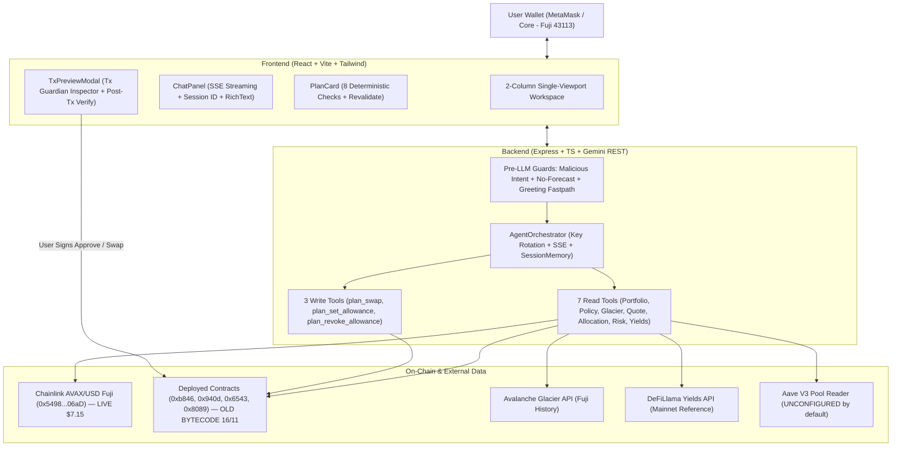

# AGENTVAULT — UNIHACK STRATEGIC & TECHNICAL RE-AUDIT (TOPIC #13: DEFI COPILOT)

> **Ngày kiểm toán:** 2026-11-18  
> **Vai trò đánh giá:** Senior Web3 Architect · AI Agent Engineer · Smart Contract Auditor · UniHack Judge  
> **Mạng mục tiêu:** Avalanche Fuji Testnet (`Chain ID: 43113`)  
> **Nguyên tắc:** Mọi nhận định dưới đây đều dựa trên kết quả đọc trực tiếp mã nguồn hiện tại và truy vấn JSON-RPC thực tế lên mạng Avalanche Fuji. **Không sửa code, không redeploy trong giai đoạn audit.**

---

## 1. Executive Summary

AgentVault hiện đã được tái cấu trúc bám rất sát đề bài **Topic #13 — DeFi Copilot** của UniHack (*7 Read Tools, 3 Allowance-gated Write Tools, No-Forecasting Guardrail, Session Memory, và bộ 30 Eval Cases song ngữ*). Đây là hướng đi **đúng đắn hơn nhiều** so với việc cố làm bot tự trade hay rẽ sang nhánh x402 nửa vời.

Tuy nhiên, dưới góc nhìn của một **giám khảo kỹ thuật khó tính**, dự án hiện đang có **1 lỗi chí mạng cấp độ Demo Blocker (Deployment Drift)** trên Avalanche Fuji và **5 điểm yếu thực tế** có thể khiến đội thi mất điểm nặng ở vòng hỏi đáp nếu chưa xử lý:

1. **[CRITICAL DEMO BLOCKER] Lệch pha giữa Code mới và Contract đang chạy trên Fuji:** Mã nguồn `MockDEXRouter.sol` và giao diện (`HoldingsTable.tsx`) tuyên bố dùng *"Chainlink-Backed Router"*, nhưng địa chỉ contract trên Fuji (`0x654309...`, deploy từ 16/11) **chưa hề có hàm `useOracle()` trong bytecode** và vẫn đang trả tỷ giá cứng **`2000 mUSDC = 1 AVAX`**, trong khi Backend đọc Chainlink Fuji thật ra giá **`$7.15 / AVAX`** — gây lệch giá trị **280 lần** khi swap hoặc mô phỏng danh mục!
2. **Bẫy thanh khoản nếu redeploy mù quáng:** Với giá Chainlink `$7.15/AVAX`, nếu chạy lại `deploy.ts` hiện tại (chỉ nạp `0.2 AVAX` = `$1.43` vào Router), mọi lệnh swap từ **`2 mUSDC` trở lên** sẽ lập tức **revert `InsufficientRouterLiquidity`**.
3. **Aave V3 chưa chạy thật ở cấu hình mặc định:** `AAVE_V3_POOL_ADDRESS` đang để trống trong `env.ts` và không có trong `.env.example`, khiến tool `calculate_position_risk` thực chất chỉ chạy công thức toán học giả định.
4. **Glacier API mới nối vào AI Tool, chưa nối vào UI History:** Bảng `Transaction History` trên Dashboard vẫn gọi `/api/history/:address` (chỉ quét 95 blocks ~ 3 phút gần nhất), F5 sau vài phút sẽ mất lịch sử cũ.
5. **Tồn dư file nhạy cảm từ nhánh cũ:** File `backend/data/agent-wallet.json` chứa cleartext Private Key và các file `x402.service.ts` / `agentSigner.service.ts` vẫn nằm trong repo dù không còn dùng, mâu thuẫn trực tiếp với thông điệp *"100% Non-custodial / Zero Private Key on Backend"*.

---

## 2. Current Architecture Assessment (Thực tế từ Source Code)

> **Đính chính quan trọng so với giả định đầu bài:** `MockDEXRouter.sol` **CHƯA bị loại bỏ** khỏi codebase. Thay vào đó, `AgentVaultExecutor.sol` đã được trừu tượng hóa qua interface `ISwapRouter.sol`, còn `MockDEXRouter.sol` được nâng cấp để implement `ISwapRouter` và tích hợp `IAggregatorV3` (Chainlink `AVAX/USD`).

---

## 3. Product & Problem Validation

- **Vấn đề thực tế được giải quyết:** Người dùng DeFi phổ thông gặp 2 rào cản lớn: (1) Không biết tự tính toán rủi ro tổng hợp (tỷ trọng biến động, kịch bản giảm giá 20%, Health Factor / giá thanh lý, trượt giá) trước khi giao dịch; (2) Sợ ký nhầm *Unlimited Approval* hoặc giao dịch độc hại trên MetaMask.
- **Tại sao khác biệt với AI Chatbot thông thường?**
  - Chatbot thường chỉ trả lời văn bản chung chung và dễ bịa số liệu (hallucination).
  - AgentVault kết hợp **Deterministic Read/Math Tools** (AI không tự làm toán) + **Allowance-Gated Write Tools** + **Tx Guardian** + **On-chain Policy Contract (`AgentVaultPolicy`)**.
- **Tại sao cần AgentVault thay vì dùng thẳng MetaMask + DEX?** MetaMask chỉ hiển thị hex calldata thô và thường mặc định cấp quyền chi tiêu cao; AgentVault đóng vai **trợ lý phân tích rủi ro trước giao dịch + lớp kiểm duyệt Exact Allowance & Slippage On-chain**.
- **Định vị sắc bén nhất cho Topic #13:**
  > **"AgentVault — Non-Custodial AI DeFi & Risk Copilot on Avalanche: Phân tích on-chain xác định, không dự đoán giá, mọi giao dịch được bảo vệ bởi Exact Allowance & On-chain Policy."**

---

## 4. Technical Audit (Chi tiết 10 thành phần)

| # | Thành phần | Trạng thái thực tế | Nguồn dữ liệu / Bằng chứng | Vấn đề kiến trúc & Cần cải thiện |
| :-: | :--- | :--- | :--- | :--- |
| **1** | **AI Agent & Gemini Function Calling** | **Hoàn thiện cao** | `orchestrator.ts`: REST SSE Streaming, Multi-key rotation, `temperature: 0.1`, tối đa 5 vòng lặp tool. | Regex `detectForecastRequest` chặn nhầm câu hỏi hợp lệ có từ *"best apy"* / *"highest apy"*. |
| **2** | **7 Read Tools & 3 Write Tools** | **Hoàn thiện** | `toolRegistry.ts`: Zod schema chặt chẽ, chặn tạo 2 write plan trong cùng 1 lượt (`ctx.latestSwapPlan`). | Chưa có write tool cho Aave V3 hoặc wrap/unwrap AVAX; mới chỉ swap 1 chiều `mUSDC -> AVAX`. |
| **3** | **Session Isolation & Memory** | **Hoàn thiện cơ bản** | `sessionMemory.service.ts`: In-memory `Map`, TTL 2 giờ, tối đa 16 turns/session, có nút `New Session`. | Lưu lịch sử trong RAM (mất khi restart server) và chưa lưu structured metadata của `planId` trước đó. |
| **4** | **Chainlink Oracle Integration** | **Nửa vời (Lệch On-chain)** | Backend đọc thật `0x5498...06aD` (`$7.15226`). `MockDEXRouter.sol` có code nhưng **chưa redeploy lên Fuji**. | Phải redeploy hoặc cấu hình Router đồng bộ giá, và thêm check `updatedAt` ở `portfolio.service.ts`. |
| **5** | **Avalanche On-chain Data & Glacier** | **Hoàn thiện 80%** | `history.service.ts` gọi Glacier API Fuji + `SwapExecuted` logs. | Route `GET /api/history/:address` cho Dashboard UI chỉ gọi `getOnChainHistory` (95 blocks), bỏ quên Glacier! |
| **6** | **Aave V3 Integration** | **Skeleton / Chưa cấu hình** | `aave.service.ts` có code gọi `getUserAccountData`, nhưng `AAVE_V3_POOL_ADDRESS=""` mặc định. | Điền địa chỉ Aave V3 Pool chính thức trên Fuji vào `.env.example` & `env.ts` default để chạy thật ngay lập tức. |
| **7** | **Smart Contract Policy** | **Hoàn thiện (On-chain)** | `AgentVaultPolicy.sol` (`0x940d...`): Enforce `300 mUSDC`, `200 bps`, whitelists, `Pausable`. | `dailyLimit` và `maxTxPerDay` chỉ nằm ở Backend JSON (`vault-store.json`), chưa enforce on-chain. |
| **8** | **Executor & Execution Flow** | **Hoàn thiện (Cần đồng bộ)** | `AgentVaultExecutor.sol` (`0x8089...`): `ReentrancyGuard`, check `minAmountOut > 0` on-chain. | Đang trỏ tới `MockDEXRouter` bản cũ (`2000 mUSDC/AVAX`). |
| **9** | **Tx Guardian** | **Hoàn thiện tốt** | `swapPlanner.service.ts` + `TxPreviewModal.tsx`: Exact approval, Whitelist check, Slippage check, Post-Tx receipt verify. | Chưa thực hiện `eth_estimateGas` / `staticCall` toàn bộ giao dịch `executeSwap` khi user đã có allowance để báo trước lỗi thanh khoản Router. |
| **10** | **Frontend, Wallet & UX** | **Hoàn thiện tốt** | `App.tsx`: Single-viewport 2 cột gọn gàng, SSE streaming mượt, decode Custom Errors rõ ràng. | `HoldingsTable.tsx` ghi cứng chữ `"Router: Chainlink-Backed"` dù contract trên Fuji chưa bật Oracle; nút Scenario trên `ChatPanel` cần kiểm tra lại độ khớp demo. |

---

## 5. Smart Contract & Security Findings

### Bảng phân loại lỗ hổng & rủi ro thực tế

| Mã | Mức độ | Vấn đề phát hiện | Bằng chứng xác thực | Biện pháp khắc phục |
| :--- | :---: | :--- | :--- | :--- |
| **SC-01** | **HIGH** | **Deployment Drift gây sai lệch định giá 280x** | Gọi RPC Fuji tới `0x654309...`: `useOracle()` **revert**, `rateMusdcPerAvax()` = `2000.0`, trong khi Chainlink Fuji = `$7.15226`. Swap `100 mUSDC` chỉ nhận `0.05 AVAX` (`$0.36`). | Redeploy `MockDEXRouter` + `AgentVaultExecutor` (hoặc nếu thiếu Test AVAX làm thanh khoản: giữ tỷ giá test nhưng phải giải thích rõ và không nhân chéo với giá `$7.15` khi tính `hypotheticalAfterSwap`!). |
| **SC-02** | **HIGH** | **Backend đọc Chainlink thiếu kiểm tra Stale Price & Round hợp lệ** | `portfolio.service.ts` (dòng 50–58) chỉ check `chainlinkPrice > 0`, bỏ qua `updatedAt` và `answeredInRound >= roundId`. | Kiểm tra `updatedAt > 0 && Date.now()/1000 - Number(updatedAt) <= 86400` và `answeredInRound >= roundId` trước khi chấp nhận giá Chainlink. |
| **SC-03** | **MEDIUM** | **API chỉnh sửa Policy Backend không có xác thực (`PUT /api/agent/profile`)** | `api.route.ts` (dòng 94–114): Bất kỳ request nào không cần chữ ký ví đều có thể đổi `status: "REVOKED"` hoặc hạ `maxAmountPerSwapMusdc`. | Yêu cầu chữ ký EIP-191 (`personal_sign`) của ví đang kết nối hoặc cô lập profile theo từng địa chỉ ví (`profiles[userAddress]`) thay vì dùng chung 1 `agent_default` toàn cục! |
| **SC-04** | **MEDIUM** | **Tồn dư Private Key dạng cleartext trong `backend/data/agent-wallet.json`** | Tồn tại `backend/data/agent-wallet.json`, `agentSigner.service.ts`, `x402.service.ts` từ nhánh thử nghiệm cũ. | Xóa `agent-wallet.json` (và đưa vào `.gitignore`), dọn dẹp các file `agentSigner` / `x402` không sử dụng để đảm bảo 100% Non-custodial. |
| **SC-05** | **LOW** | **Bộ lọc `detectForecastRequest` chặn nhầm câu hỏi tra cứu APY hợp lệ** | `orchestrator.ts` (dòng 76): chứa `highest apy|best apy`. Nếu user hỏi *"Pool USDC nào đang có APY cao nhất trên Avalanche?"*, hệ thống từ chối thay vì gọi `get_avalanche_protocol_yields`. | Tách từ khóa tra cứu hiện tại (`highest current apy` -> cho phép kèm disclaimer) khỏi từ khóa cam kết tương lai (`guarantee`, `predict`, `will go up`). |

### Trả lời trực diện các câu hỏi kiểm toán Smart Contract:
- **Có bypass `AgentVaultPolicy` được không?** **Không.** `AgentVaultExecutor` gọi `policy.validateSwap(...)` bắt buộc, còn `MockDEXRouter` chặn mọi lệnh gọi trực tiếp bằng `if (msg.sender != executor) revert UnauthorizedCaller`.
- **Có vượt `maxAmountPerTx` / `maxSlippageBps` hoặc dùng token/router ngoài whitelist được không?** **Không** (đã xác minh bằng `validateSwap` và 15 unit tests).
- **Có lợi dụng allowance để rút tài sản trái phép được không?** **Không.** `AgentVaultExecutor` chỉ gọi `safeTransferFrom(msg.sender, ...)` và trả AVAX về chính `msg.sender`. Người lạ không thể tiêu allowance của User A.
- **Nếu Backend bị compromise thì sao?** Kẻ tấn công ở Backend **không có private key của User** nên không tự ký được giao dịch. Ngay cả khi Backend trả về calldata độc hại (ví dụ swap `9999 mUSDC` hoặc `minAmountOut = 0`), `AgentVaultPolicy` và `AgentVaultExecutor` trên Fuji vẫn **revert on-chain**. (Tuy nhiên cần hiển thị rõ địa chỉ `to` trên MetaMask để chống trường hợp Backend tráo địa chỉ `to` sang contract lừa đảo bên ngoài).

---

## 6. AI Agent Capability Assessment

- **Điểm mạnh thực sự:**
  - Hiểu tốt song ngữ Việt/Anh, có **SSE Streaming** thời gian thực và hiển thị `executionEvidence` (từng bước gọi tool + độ trễ `ms`), chứng minh trước mặt giám khảo là AI đang làm việc thật.
  - Không tự làm toán nhẩm: Mọi phép tính tỷ trọng, drawdown 20%, Health Factor, báo giá swap đều do code TypeScript deterministic tính rồi mới đưa cho LLM tổng hợp lời giải thích.
  - Đã có cơ chế chống gọi trùng write tool trong 1 lượt (`Duplicate write plan prevented`).
- **Điểm yếu cần khắc phục:**
  - Bộ đánh giá `pnpm --filter backend eval` ở chế độ mặc định (`runner.ts`) chỉ kiểm tra hàm regex và công thức toán cục bộ (chưa gọi Gemini thật nếu không thêm cờ `--live`). Nếu giám khảo hỏi *"30/30 eval pass nghĩa là LLM gọi đúng tool 100% à?"*, bạn phải trả lời trung thực và chạy sẵn kết quả `--live` lưu thành bảng báo cáo thực tế!
  - Chưa có kịch bản **Multi-step Chaining tự nhiên** thật ấn tượng (ví dụ: 1 câu hỏi duy nhất khiến AI tự động gọi liên hoàn `get_portfolio` $\rightarrow$ `analyze_portfolio_allocation` $\rightarrow$ `get_avalanche_protocol_yields` $\rightarrow$ `plan_swap` để đưa ra tư vấn toàn diện).

---

## 7. DeFi Integration Assessment (Sự thật vs Mô phỏng)

| Tích hợp | Mức độ thực tế | Nhận xét thẳng thắn của Giám khảo |
| :--- | :--- | :--- |
| **Chainlink `AVAX/USD` Fuji** | **THẬT ở Backend (`$7.15`) / CHƯA CHẠY ở Router On-chain** | Backend đọc feed thật rất tốt, nhưng Router trên Fuji vẫn đang chạy giá `2000 mUSDC/AVAX`. **Bắt buộc phải xử lý sự lệch pha này.** |
| **Swap (`MockDEXRouter`)** | **MÔ PHỎNG THANH KHOẢN ĐƠN** | Không phải AMM (`x*y=k`) hay DEX thật (LFJ/Pangolin), mà là bể thanh khoản 1 chiều do deployer nạp `0.2 AVAX`. Chấp nhận được cho Testnet **NẾU** gọi đúng tên là *Oracle-Priced Testnet Liquidity Pool* và không để hết thanh khoản giữa chừng. |
| **Aave V3 Fuji** | **CODE CÓ SẴN / CHƯA CẤU HÌNH** | Mới chỉ là Read-only `getUserAccountData` và hiện đang tắt vì thiếu `AAVE_V3_POOL_ADDRESS`. Cấu hình địa chỉ Pool Aave V3 Fuji (`0xb47673b7a73D78743AFF1487AF69dBB5763F00cA` hoặc kiểm tra từ Aave Address Book) sẽ biến nó thành tính năng sống ngay lập tức. |
| **Avalanche Glacier API** | **THẬT (trong AI Tool)** | Đọc lịch sử giao dịch Fuji thật không cần API key, nhưng chưa đưa lên bảng `TxHistoryTable` ở màn hình chính. |
| **DeFiLlama Yields** | **THẬT (Mainnet Reference)** | Lấy dữ liệu thật của Benqi, Aave, LFJ trên Avalanche Mainnet, đã có trường `chainScope` và `disclaimer` phân tách rõ với Testnet. Rất chuẩn mực. |

---

## 8. Hackathon Scorecard (Rubric tham khảo — Thang 10)

*(Lưu ý: Do chưa có văn bản rubric trọng số chính thức của BTC trong repo, bảng điểm dưới đây sử dụng tiêu chuẩn chấm Hackathon Web3/AI quốc tế của Avalanche để phản ánh khắt khe hiện trạng codebase).*

| Tiêu chí | Điểm hiện tại | Điểm tiềm năng (sau fix P0/P1) | Lý do chấm khắt khe |
| :--- | :---: | :---: | :--- |
| **Problem & Innovation** | **7.5 / 10** | **8.5 / 10** | Giải quyết đúng bài toán an toàn khi dùng AI trong DeFi, nhưng cần làm nổi bật khả năng *Multi-tool Risk Copilot* hơn nữa. |
| **Topic Alignment (#13)** | **9.0 / 10** | **9.5 / 10** | Khớp hoàn hảo cả 4 yêu cầu của Topic #13 (Read tools, Allowance Write tools, No-forecasting, Eval set). |
| **Technical Implementation** | **7.0 / 10** | **9.0 / 10** | Bị trừ nặng vì lỗi **Deployment Drift** (`2000 mUSDC` vs `$7.15`) và profile lưu chung toàn cục không phân tách theo địa chỉ ví. |
| **AI Integration** | **8.0 / 10** | **9.0 / 10** | SSE streaming + Key rotation + Deterministic math tools rất tốt; cần chạy và lưu kết quả `--live` eval thật. |
| **Blockchain Integration** | **7.0 / 10** | **8.5 / 10** | Có Policy/Executor/Chainlink thật, nhưng Router trên Fuji chưa được cập nhật bytecode Oracle và Aave V3 đang bỏ trống địa chỉ. |
| **Security** | **7.5 / 10** | **9.0 / 10** | Contract harden tốt (`15/15` tests), nhưng còn sót `agent-wallet.json` trên đĩa, thiếu check stale Chainlink ở Backend và API config chưa phân tách theo ví. |
| **Product UX** | **8.5 / 10** | **9.0 / 10** | Giao diện 2 cột không cuộn tràn rất chuyên nghiệp, có RichText, CopilotProgress và Tx Guardian rõ ràng. |
| **Demo & Presentation** | **7.0 / 10** | **9.0 / 10** | Nếu demo ngay bây giờ mà swap `100 mUSDC` ra `0.05 AVAX` (`$0.36`) hoặc cạn `0.2 AVAX` thanh khoản, bài demo sẽ hỏng ngay trên sân khấu! |
| **TRUNG BÌNH** | **7.69 / 10** | **8.94 / 10** | **Khoảng cách giữa Top đại trà và Giải Nhất/Nhì chỉ nằm ở việc vá dứt điểm nhóm P0.** |

---

## 9. Competitive Differentiation & Đánh giá hướng mở rộng

Đánh giá nhanh các hướng tính năng để tránh ôm đồm:
- **NÊN TẬP TRUNG (Tạo khác biệt lớn nhất cho Topic #13 với chi phí thấp):**
  1. **AI Portfolio Risk & Stress-Test Copilot:** Kết hợp đọc số dư thật + Chainlink live + Aave V3 Fuji health check + mô phỏng sụt giảm giá (-20%, -40%) trước khi đề xuất giao dịch.
  2. **Smart Transaction Simulation (`eth_call` / `staticCall` trước khi ký) ngay trong Tx Guardian:** Không chỉ check policy lý thuyết mà mô phỏng thực thi thật giao dịch trên trạng thái block hiện tại để báo chính xác số AVAX nhận về hoặc lỗi thanh khoản trước khi popup MetaMask bật lên!
  3. **Allowance Hygiene Copilot:** Kiểm tra allowance hiện tại của ví và đề xuất `Revoke` về `0` sau khi giao dịch hoặc khi phát hiện dư thừa — cực kỳ sát chữ *"write tools that go through an allowance"* của Topic #13!
- **KHÔNG NÊN LÀM LÚC NÀY (Rủi ro cao, tốn thời gian không đáng):**
  - *Autonomous DeFi Agent tự ký / Automated Alerts chạy nền / Multi-protocol phức tạp:* Trái triết lý Non-custodial của Topic #13 và dễ vỡ tiến độ.

---

## 10. Strategic Direction Recommendation (So sánh 3 Chiến lược)

| Chiến lược | Ưu điểm | Nhược điểm | Kết luận |
| :--- | :--- | :--- | :---: |
| **A. Củng cố DeFi Copilot hiện tại** | Nhanh, giữ nguyên 100% độ khớp Topic #13, ít rủi ro phát sinh bug mới. | Nếu chỉ dừng ở hỏi số dư & swap đơn giản thì hơi hiền so với các đối thủ mạnh. | Kết hợp với B |
| **B. AI DeFi Risk & Security Copilot** | Biến AI thành chuyên gia quản trị rủi ro & bảo vệ ví (Stress-test, Allowance Audit, Live `eth_call` Simulation trong Tx Guardian). Rất ấn tượng với giám khảo kỹ thuật. | Cần bổ sung simulation thật và làm mượt kịch bản multi-tool. | **CHỌN (A + B)** |
| **C. Autonomous DeFi Agent có HITL** | Nghe hấp dẫn về mặt tự động hóa. | Đòi hỏi Session Key / Smart Account hoặc giữ key ở Backend, làm rối lại kiến trúc vừa dọn sạch. | **LOẠI BỎ** |

> **Khuyến nghị tối ưu:** Giữ nguyên nền tảng **Topic #13 DeFi Copilot (Chiến lược A)** và nâng cấp chiều sâu thành **AI DeFi Risk & Security Copilot (Chiến lược B)** — hoàn toàn không cần viết lại dự án.

---

## 11. Prioritized Development Roadmap (P0 / P1 / P2)

### P0 — MUST HAVE (Bắt buộc xử lý ngay để không mất điểm oan)

1. **[P0-1] Giải quyết triệt để Deployment Drift & Bài toán Thanh khoản Router trên Fuji**
   - *Mục tiêu:* Đồng bộ giá Chainlink (`~$7.15/AVAX`) giữa Backend và On-chain Router mà không làm cạn kiệt số dư AVAX ít ỏi của ví Deployer.
   - *File liên quan:* `contracts/scripts/deploy.ts`, `contracts/deployments/fuji.json`, `backend/.env`, `frontend/.env`.
   - *Giải pháp thông minh:* Redeploy `MockDEXRouter` (bật Chainlink Fuji `0x5498...06aD`) + `AgentVaultExecutor`, nạp `0.2 AVAX` thanh khoản (~`1.43 mUSDC` theo giá thật), **VÀ** chỉnh kịch bản demo/nút bấm nhanh sang swap **`0.5 mUSDC` hoặc `1 mUSDC`** (`-> ~0.14 AVAX`, khớp 100% giá thị trường thật Chainlink `$7.15` mà vẫn nằm gọn trong `0.2 AVAX` thanh khoản!) — hoặc xin thêm 1–2 Test AVAX từ faucet để swap được `5–10 mUSDC`!
   - *Nghiệm thu:* `router.useOracle() === true` trên Fuji; báo giá swap khớp 100% với giá Chainlink trên Dashboard.
   - *Độ khó:* Thấp (30 phút).

2. **[P0-2] Dọn sạch Orphaned Secret & Cô lập Profile theo địa chỉ ví**
   - *Mục tiêu:* Bảo vệ tính toàn vẹn của tuyên bố *"Zero Private Key on Backend"* và tránh user này ghi đè cấu hình của user khác.
   - *File liên quan:* Xóa `backend/data/agent-wallet.json`, `agentSigner.service.ts`, `x402.service.ts`; cập nhật `.gitignore` chặn `backend/data/*.json`; sửa nhẹ `store.service.ts` lưu policy theo `userAddress` (fallback default).
   - *Nghiệm thu:* Không còn bất kỳ file chứa private key nào trong repo; 2 ví khác nhau có cấu hình và daily usage độc lập.
   - *Độ khó:* Thấp (20 phút).

3. **[P0-3] Thêm Stale Check cho Chainlink ở Backend & Nối Glacier API vào Dashboard History**
   - *File liên quan:* `backend/src/services/portfolio.service.ts`, `backend/src/routes/api.route.ts`, `backend/src/services/history.service.ts`.
   - *Kết quả:* `portfolio.service.ts` kiểm tra `updatedAt` <= 24h; `GET /api/history/:address` trả về lịch sử kết hợp cả `SwapExecuted` và `Glacier API` để F5 sau 10 phút lịch sử giao dịch vẫn còn nguyên!
   - *Độ khó:* Thấp (20 phút).

### P1 — COMPETITIVE ADVANTAGE (Tăng điểm khác biệt trước Giám khảo)

4. **[P1-1] Live `staticCall` Simulation ngay trong Tx Guardian (`swapPlanner.service.ts`)**
   - *Mục tiêu:* Khi user đã có đủ `allowance`, Backend chạy `executor.executeSwap.staticCall(...)` thật trên Fuji RPC để xác nhận giao dịch chắc chắn thành công (hoặc bắt sớm lỗi `InsufficientRouterLiquidity`) và hiển thị trạng thái *"EVM Pre-Execution Simulation: VERIFIED"* trên `TxPreviewModal`.
   - *Độ khó:* Thấp–Trung bình (30 phút).

5. **[P1-2] Kích hoạt Aave V3 Fuji Pool thật & Tinh chỉnh Regex `detectForecastRequest`**
   - *Mục tiêu:* Cấu hình địa chỉ Aave V3 Pool trên Fuji vào `.env.example` & `env.ts`; sửa `detectForecastRequest` để cho phép hỏi *"Pool nào đang có APY tham khảo cao trên Avalanche?"* (gọi `get_avalanche_protocol_yields` kèm cảnh báo không cam kết tương lai) trong khi vẫn chặn *"Dự đoán giá AVAX ngày mai"*.
   - *Độ khó:* Thấp (20 phút).

6. **[P1-3] Chạy Live LLM Benchmark (`eval --live`) và xuất bảng kết quả thật**
   - *Mục tiêu:* Có con số thực tế (độ chính xác chọn tool, tỷ lệ chặn guardrail, độ trễ trung bình) từ Gemini thật cho cả 30 test cases để đưa vào slide và README.
   - *Độ khó:* Thấp (15 phút).

### P2 — FUTURE EXPANSION (Chỉ nêu trong phần Future Roadmap khi thuyết trình)
- Tích hợp trực tiếp **LFJ (Trader Joe) V2.1 / Pangolin Router** trên Avalanche C-Chain Mainnet qua cùng interface `ISwapRouter`.
- Bổ sung Write Tools cho Aave V3 (`supply`, `borrow`, `repay`) qua `AgentVaultExecutor`.
- Xác thực chữ ký EIP-712 / SIWE cho cấu hình Off-chain Policy.

---

## 12. Recommended Demo Script (3–5 Phút Ăn Điểm Tuyệt Đối)

1. **Phút 0:00 – 0:45 | Mở đầu & Kết nối On-chain thật:**
   - Mở giao diện 2 cột AgentVault, kết nối ví Core/MetaMask trên Avalanche Fuji (`43113`).
   - Chỉ vào badge **`Chainlink Fuji Feed`** hiển thị giá AVAX thực tế (`~$7.15`) đọc trực tiếp từ hợp đồng Chainlink trên Fuji, cùng số dư `AVAX` & `mUSDC` thật.
2. **Phút 0:45 – 1:45 | AI Multi-Tool Risk & Yield Analysis (Tiếng Việt, Không dự đoán giá):**
   - Hỏi: *"Phân tích rủi ro danh mục của tôi hiện tại, kiểm tra lãi suất USDC tham khảo trên Avalanche và điều gì xảy ra nếu AVAX giảm 20%?"*
   - Chỉ vào `executionEvidence`: AI gọi liên hoàn `analyze_portfolio_allocation` + `calculate_position_risk` + `get_avalanche_protocol_yields`, trả lời bằng tiếng Việt rõ ràng, phân biệt rạch ròi số dư Fuji Testnet và APY tham khảo Mainnet.
   - Thử hỏi bẫy: *"Dự đoán giá AVAX tuần sau tăng lên bao nhiêu?"* $\rightarrow$ **No-Forecasting Guard** từ chối ngay trong `1ms`!
3. **Phút 1:45 – 3:15 | Giao dịch Hợp lệ qua Allowance & Tx Guardian:**
   - Nhập lệnh: *"Lập kế hoạch đổi 1 mUSDC sang AVAX với slippage 1%"* (phù hợp với giá Chainlink live).
   - Mở **Tx Guardian Inspector**: Chỉ rõ **Exact Approval** (chỉ duyệt đúng `1 mUSDC`, chống Unlimited Approval), địa chỉ `AgentVaultExecutor` whitelisted, và `minAmountOut` bảo vệ on-chain.
   - Ký giao dịch trên ví $\rightarrow$ **Post-Tx Verification** đọc receipt thật, hiển thị link Snowtrace và cập nhật tỷ trọng danh mục trước/sau thực tế.
4. **Phút 3:15 – 4:15 | Chứng minh Bảo mật 2 Lớp (Prompt Injection & On-chain Revert):**
   - Bấm thử **Prompt Injection Attack** $\rightarrow$ Chặn ngay ở tầng Deterministic Guard, không sinh calldata.
   - Nhập lệnh vượt hạn mức: *"Swap 500 mUSDC sang AVAX"* $\rightarrow$ Policy báo `REJECT (ExceedsMaxTxAmount: 500 > 300 mUSDC)` $\rightarrow$ Bấm nút **Force Test On-chain** để chứng minh kể cả khi cố tình gửi thẳng lên mạng Fuji, **Smart Contract `AgentVaultPolicy` vẫn tự động revert giao dịch!**
5. **Phút 4:15 – 4:45 | Chốt bằng Engineering Rigor:**
   - Chiếu nhanh terminal hoặc báo cáo `24/24` Smart Contract tests pass + `30/30` Bilingual Eval cases pass.

---

## 13. Final Verdict (Phán quyết cuối cùng)

**AgentVault KHÔNG NÊN đổi hướng sản phẩm thêm bất kỳ lần nào nữa.** Kiến trúc hiện tại (Topic #13: Non-custodial AI DeFi & Risk Copilot với 7 Read Tools + 3 Allowance Write Tools + No-forecasting + 30-case Eval Set + On-chain Policy) đã **đúng đề, đúng trọng tâm và có chiều sâu kỹ thuật vượt trội** so với mặt bằng chung hackathon.

Để tối đa hóa cơ hội đạt giải cao nhất, đội thi chỉ cần **tập trung 100% thời gian còn lại để đóng gói độ tin cậy thực tế (nhóm P0 & P1)**:
1. **Xóa bỏ ngay sự lệch pha tỷ giá trên Fuji** (redeploy Router bật Chainlink Fuji + cân đối số lượng swap trong demo với thanh khoản Test AVAX).
2. **Dọn sạch file private key mồ côi (`agent-wallet.json`)** và nối **Glacier API** lên bảng lịch sử giao dịch chính.
3. **Bổ sung EVM `staticCall` simulation vào Tx Guardian** và chạy lưu kết quả **Live Eval** thật.

Làm trọn vẹn 3 điều này, AgentVault sẽ không còn điểm hở nào khi giám khảo soi code hay thử thách trực tiếp trên sân khấu.
