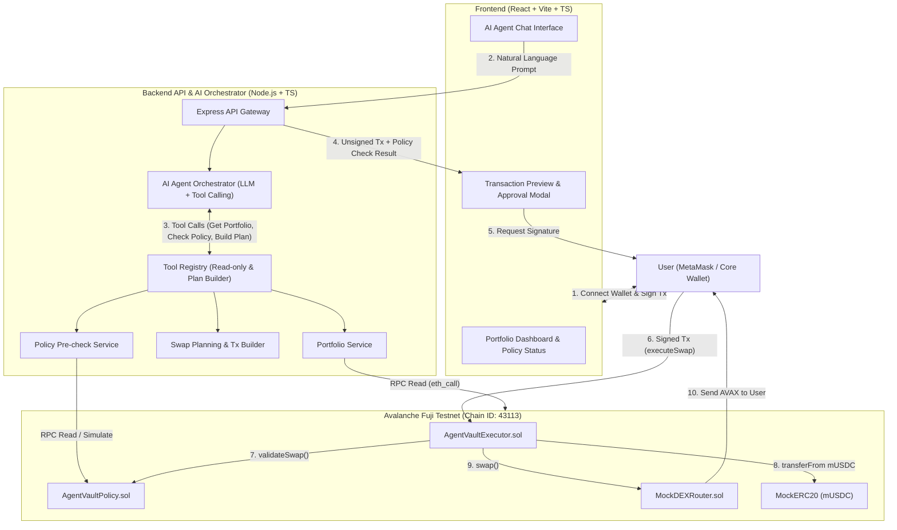

# SYSTEM OVERVIEW – AGENTVAULT

> **Định vị:** Policy-Governed AI Agent for Autonomous DeFi Portfolio Management on Avalanche  
> **Phiên bản tài liệu:** 1.0 (MVP 5-Day Hackathon Blueprint)  
> **Trạng thái Workspace Audit:** Đã hoàn tất kiểm tra `d:\HACKATHON\UNIHACK` (hiện chỉ có `setup.md`; chưa có source code và chưa tìm thấy `EduRefAI` trong workspace).

---

## 1. Kết quả Workspace Audit

### 1.1. Existing Workspace (`d:\HACKATHON\UNIHACK`)
- **Cấu trúc hiện tại:** Chỉ tồn tại 1 file duy nhất là `setup.md` (142 dòng, mô tả định hướng dùng Avalanche Fuji Testnet, Mock USDC, Policy Engine, Mock DEX/Testnet DEX, Gemini Function Calling và 2 kịch bản demo A/B).
- **Source code / Config hiện có:** Chưa có `package.json`, `tsconfig.json`, `contracts/`, `backend/`, `frontend/`, `.env`, `docker-compose.yml` hay `.git`.
- **Môi trường phát triển đã cài đặt trên máy:**
  - Node.js: `v20.19.5`
  - npm: `10.8.2`
  - pnpm: `12.16.1`
  - Git: `2.48.1.windows.1`
  - Docker: `28.5.2` (lưu ý: có cảnh báo quyền truy cập `C:\Users\acer\.docker\config.json` khi chạy trong sandbox).
  - Python: Chưa được cài đặt / chưa có trong `PATH`.

### 1.2. Reference Project (`EduRefAI`) & Tài liệu tham khảo
- **EduRefAI:** `UNKNOWN / NOT FOUND IN WORKSPACE`. Không tìm thấy thư mục `EduRefAI` trong `d:\HACKATHON\UNIHACK` hoặc `d:\HACKATHON\`. Cần người dùng cung cấp đường dẫn tuyệt đối nếu muốn audit và tái sử dụng pattern từ `EduRefAI`.
- **Hình ảnh tham khảo người dùng cung cấp:**
  1. *UI Dashboard Reference ("Crypto Clarity AI")*: Dark theme, sidebar điều hướng bên trái, biểu đồ tròn Asset Allocation, bảng Top Holdings (Asset, Price, Balance, Value, 24h), khối AI Insights cảnh báo rủi ro tập trung tài sản.
  2. *Architecture Reference ("AI Wallet Policy Engine Architecture")*: Luồng AI Agent → Transaction Request → Policy Engine (Rules Engine, Whitelist/Blacklist, Policy Enforcement) → Approved/Denied → Isolated Signer Module (User Wallet) → Signed Transaction.

---

## 2. Tổng quan sản phẩm (Product Overview)

### 2.1. Vấn đề & Giải pháp
- **Vấn đề:** AI Agent trong DeFi có thể hiểu ngôn ngữ tự nhiên và đề xuất chiến lược giao dịch, nhưng việc trao toàn quyền ví (private key) cho AI tiềm ẩn rủi ro mất tiền do hallucination, prompt injection hoặc sai tham số.
- **Giải pháp AgentVault:** Tách bạch hoàn toàn **AI Planning** (tư duy và lập kế hoạch) khỏi **On-chain Policy Enforcement** (kiểm soát quyền hạn trên Smart Contract) và **User Signing** (người dùng tự ký giao dịch qua ví cá nhân).
- **Nguyên tắc cốt lõi:** *AI có thể lập kế hoạch và đề xuất hành động, nhưng KHÔNG BAO GIỜ được vượt qua các chính sách bảo vệ thực thi On-chain và KHÔNG BAO GIỜ giữ private key của người dùng.*

### 2.2. Phạm vi MVP (5 ngày)
1. Kết nối ví người dùng (MetaMask / Core Wallet) trên **Avalanche Fuji Testnet** (Chain ID `43113`).
2. Portfolio Dashboard hiển thị số dư `AVAX` (native) và `mUSDC` (Mock ERC-20), tỷ trọng tài sản và thông số Policy hiện tại.
3. AI Agent (LLM + Tool Calling) tiếp nhận lệnh ngôn ngữ tự nhiên (ví dụ: *"Swap 100 USDC sang AVAX"*).
4. AI phân tích danh mục, kiểm tra Policy trước (pre-check) và trả về Transaction Preview.
5. Người dùng xác nhận và ký transaction trực tiếp trên ví.
6. Smart Contract Policy Engine kiểm tra hạn mức/whitelist/slippage on-chain trước khi cho phép thực thi swap qua Mock DEX Router (hoặc Testnet DEX).
7. Hiển thị Transaction Hash, link Avalanche Fuji Explorer, trạng thái thành công/từ chối và tự động cập nhật lại Portfolio.

### 2.3. Hai kịch bản Demo bắt buộc
- **Scenario A – Valid Transaction:** User yêu cầu swap `100 mUSDC` sang `AVAX`. Policy giới hạn `300 mUSDC/tx`. Smart Contract chấp nhận → User ký → Giao dịch thành công trên Fuji Explorer → Portfolio cập nhật.
- **Scenario B – Policy Violation:** User yêu cầu swap `500 mUSDC` sang `AVAX`. Policy giới hạn `300 mUSDC/tx`.
  - Pre-check cảnh báo vi phạm policy.
  - Nếu cố tình gửi transaction on-chain (demo bằng nút "Force Test On-chain" hoặc gọi trực tiếp contract), Smart Contract **revert** với lỗi `ExceedsMaxTxAmount` → UI hiển thị rõ lý do bị từ chối từ Smart Contract.

---

## 3. Kiến trúc tổng thể (System Architecture)

Hệ thống được thiết kế theo mô hình **Monorepo 3 lớp tối giản** (không dùng microservices, Redis, Kafka hay database phức tạp để đảm bảo hoàn thành trong 5 ngày):

```text
agentvault/
├── contracts/   # Hardhat + Solidity (MockERC20, AgentVaultPolicy, AgentVaultExecutor, MockDEXRouter)
├── backend/     # Node.js + TypeScript + Express + ethers v6 + LLM Tool Calling
└── frontend/    # React + Vite + TypeScript + TailwindCSS + ethers v6 (MetaMask/Core)
```

### 3.1. System Diagram (Mermaid)



---

## 4. Trách nhiệm các thành phần (Component Responsibilities)

| Thành phần | Công nghệ | Trách nhiệm chính | Giới hạn / Nguyên tắc |
| :--- | :--- | :--- | :--- |
| **Frontend** | React, Vite, TS, Tailwind, ethers v6 | Kết nối ví, hiển thị Portfolio/Policy/History, chat với AI, hiển thị Transaction Preview và kích hoạt ký ví. | Không lưu private key, không gọi trực tiếp LLM API key từ trình duyệt. |
| **Backend** | Node.js, Express, TS, ethers v6, Gemini SDK | Tiếp nhận prompt, điều phối LLM Tool Calling, đọc số dư on-chain, build unsigned calldata, chạy `staticCall` kiểm tra trước. | **Không giữ private key của user.** Không tự ký và broadcast giao dịch thay user. |
| **AgentVaultPolicy.sol** | Solidity ^0.8.20, OpenZeppelin | Lưu trữ và kiểm tra các rule: `maxAmountPerTx`, `allowedTokens`, `allowedRouters`, `maxSlippageBps`, `paused`. | Chỉ Owner (Admin/User quản trị) được thay đổi rule. AI không có quyền sửa rule. |
| **AgentVaultExecutor.sol** | Solidity ^0.8.20 | Điểm nhận giao dịch từ User, gọi `Policy.validateSwap()`, kéo token từ User và chuyển qua Router. | Bắt buộc revert nếu Policy từ chối. Dùng `ReentrancyGuard` và `Pausable`. |
| **MockERC20.sol** | Solidity ^0.8.20 | Token `mUSDC` (6 decimals) dùng để test trên Fuji, có hàm faucet/mint cho ví demo. | Chỉ dùng cho Testnet. |
| **MockDEXRouter.sol** | Solidity ^0.8.20 | Mô phỏng pool hoán đổi `mUSDC <-> AVAX` với tỷ giá cố định trên Fuji để demo ổn định 100%. | Có thể thay thế bằng TraderJoe/Pangolin Adapter sau MVP. |
